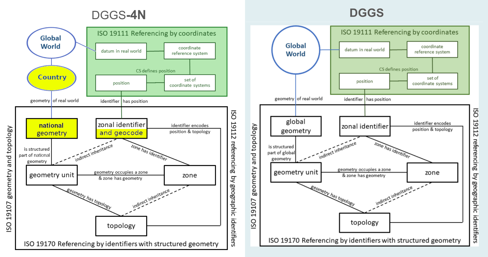

# DGGS-4N • Discrete Global Grid System for Nations

&nbsp; (see also the [rationale](https://git.AddressForAll.org/DGGS-4N/wiki) at the Wiki of this iniciative)

EXECUTIVE SUMMARY

This normative proposal, designated **DGGS-4N**, is a *tailored specification* of a reduced *profile* of [ISO&nbsp;19170-1](https://www.iso.org/standard/32588.html), which, together with [OGC Topic&nbsp;21](https://docs.ogc.org/as/20-040r3/20-040r3.html), established the concept of the DGGS – *Discrete Global Grid System*. The tailoring consists of introducing the notion of a [geocode](https://en.wikipedia.org/wiki/Geocode) and replacing the global domain with a national domain, which breaks compatibility with the base standard.

The rationale for a national grid in preference to a global one can be found in the European **INSPIRE Tile System** standard. Establishing a national grid-geocode system also meets the demand for more efficient, multipurpose postal codes, particularly in developing nations.

Although the grid domain is restricted to a national extent, **DGGS-4N ensures interoperability between countries** by imposing the same cell sizes (powers of two) on all of them. As a result, information held in cells of different countries can be compared directly. Beyond comparability, other constraints (e.g. the mandatory quadrilateral cell) ensure the reuse of grid-based methodologies and the standardization of geographic KPIs (*Geographic Key Performance Indicators*). In other words, a single *framework* is built once and reused across countries.

On the technical side, DGGS-4N allows the use of the equal-area projections already officially adopted by each country, and of conventional GIS and geoprocessing platforms, including raster-based ones. In this sense, **DGGS-4N acts as a cultural enabler for DGGS**, paving the way for the future adoption of global grids.



In the DGGS conceptual diagram shown above, only the entities highlighted in yellow were adapted to establish the **National Domain**. The key change is the replacement of the *global geometry* by a *national geometry*, formed by the level-0 cells covering the nation's jurisdictional boundaries in a projection chosen by the country itself. Replacing the globe with the nation breaks one of the theoretical and methodological foundations of DGGS. Remarkably, however, it leaves all the other conventions untouched (those not highlighted in yellow in the diagram), which fosters the development of a "DGGS culture" in situations where adopting a DGGS is not feasible.

The **DGGS-4N specification** adds the regulation of the geocode system associated with the cell identification system. This emphasis on the geocode reflects a priority of developing nations, which still lack efficient postal codes and the resources to invest in postal and other standards. The cost of deploying a standardized national grid becomes viable when it is shared with applications beyond postal services, that is, when grids and geocodes for applications such as the census and the visualization of official statistics reuse the same infrastructure.

## Please contribute!
You can post comments, suggestions, describe "bugs", etc.
* Post your comments on the text of the draft: (request to peter@addressforall.org)
* or contribute on the rationale, https://git.AddressForAll.org/DGGS-4N/wiki
* or issues https://git.AddressForAll.org/DGGS-4N/issues

## Current specification metadata 
* `title`: DGGS for Nations (DGGS‑4N)
* `subtitle`: Simplified and tailored conventions for the national domain
* `version`: 0.8.*
* `version_date`: 2026

`Contents`:
```
1. Scope	
2. Terms and definitions	
3. Model overview	
3.1. National projection, extent and coverage	
3.1.1. Equal-area profile (mandatory)	
3.1.2. Datum considerations	
3.1.3. Choice of the national coverage zones	
3.1.4. Discrete national grid	
3.2. The DGGS zone specialization in DGGS‑4N	
3.3. Grid-geocode and internal encoding processes	
3.4. National DGGRS definition	
4. Operations	
4.1 Quantization	
4.2 Identifier-based query	
4.3 Interoperation	
5. Conformance	
5.1 Requirements	
5.2 Recommendations	
5.3 Verification	
ANNEXES	
Annex A (informative) — Differences from OGC Topic 21 v2.0	
Annex B1 (informative) — Mapping of requirements to Topic 21	
Annex B2 (informative) — Mapping of requirements to Part1-Core	
Annex C — Valid zone sizes	
Annex D — Authoritative national registry	
Annex E (informative) — Geocodes as locators in extended Geo URI	
```

